# Home 2.0 — a modern home screen for Mazda Connect

A new home screen ("Ember Glass", **Ember Glance** layout) for Mazda Connect 1 infotainment units on firmware 74.
Arabic-first with full right-to-left layout, Tajawal font and Hijri date. A live status card shows the car's
warnings and service, your phone's missed calls, messages and active call, and what's playing. A small pill
opens **Android Auto** or **Apple CarPlay** when a phone is plugged in.

| Arabic · parked, everything showing | Arabic · driving, on a call, CarPlay |
|---|---|
| 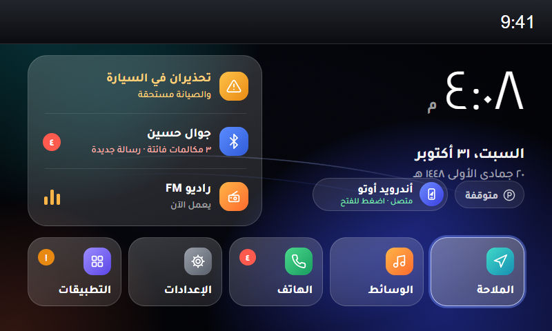 | 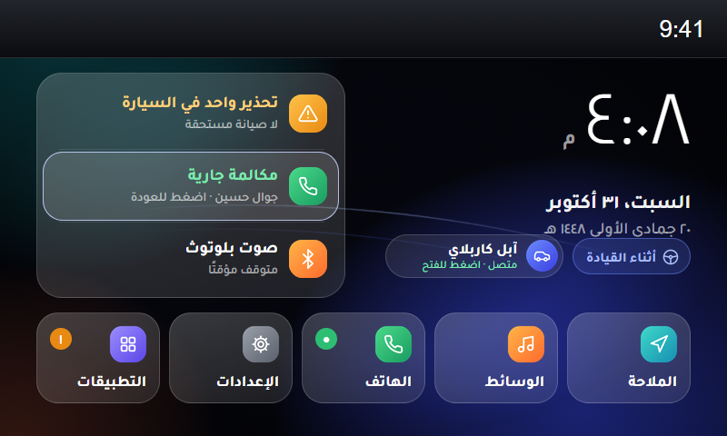 |
| **Arabic · all clear, no phone plugged in** | **English · parked, everything showing** |
| 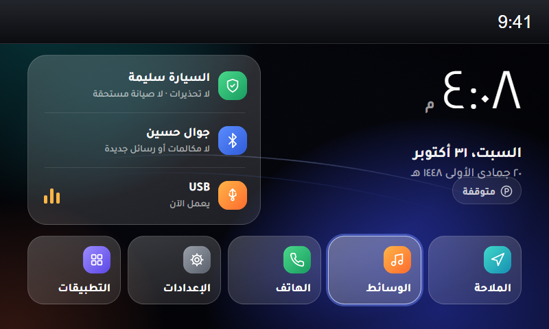 | 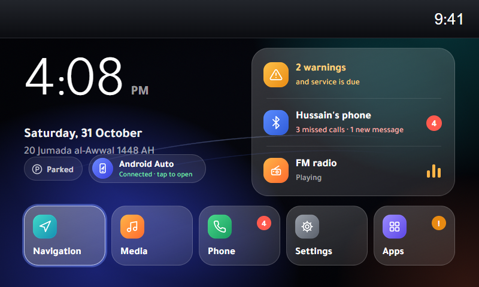 |
| **English · driving, on a call, CarPlay** | **English · all clear, no phone plugged in** |
| 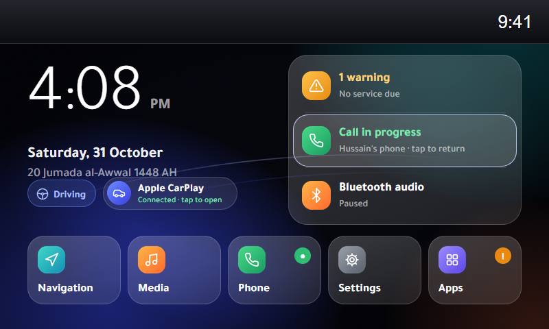 | 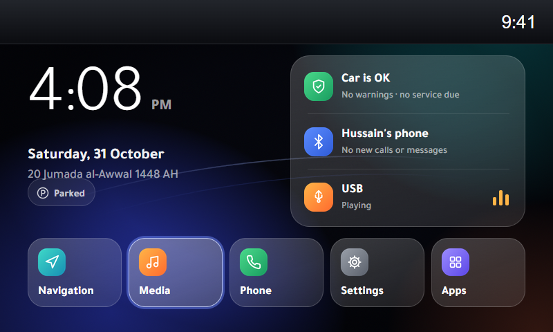 |

**System skin** — Mazda's own top bar, alerts and menus, restyled to match, in Arabic and English:

| | Settings menu | Navigation alert | Home with Android Auto | All top-bar icons |
|---|---|---|---|---|
| **Arabic** | 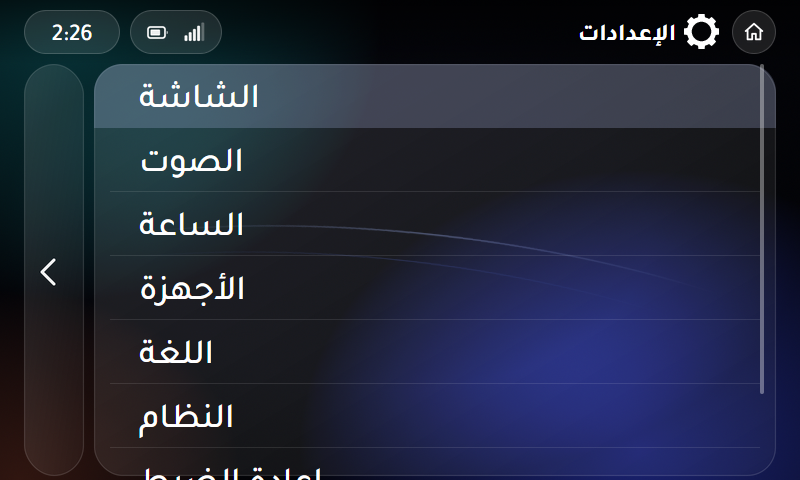 | 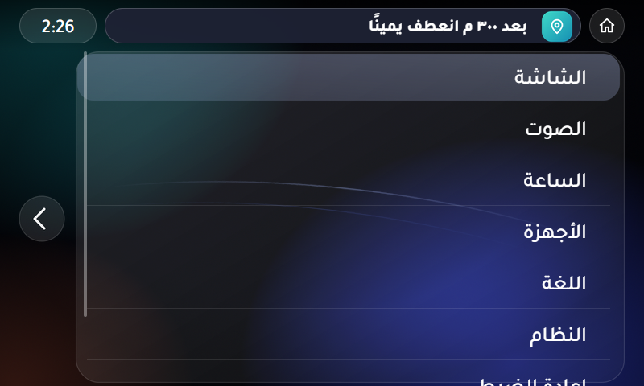 | 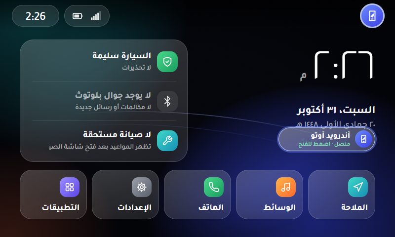 | 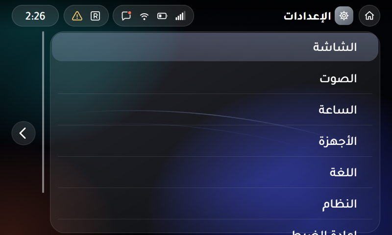 |
| **English** | 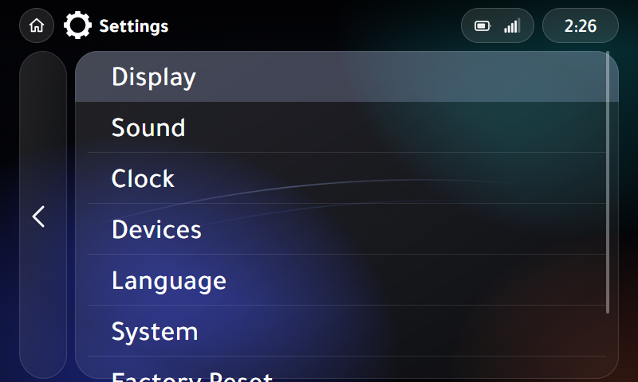 | 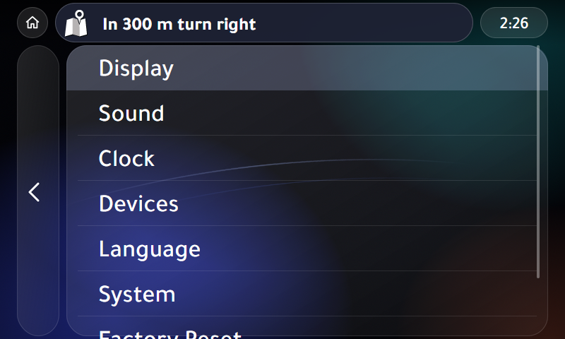 | 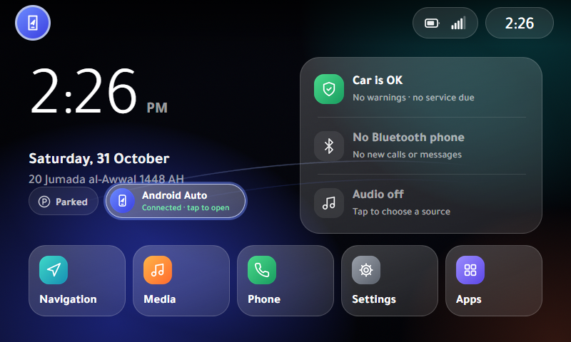 | 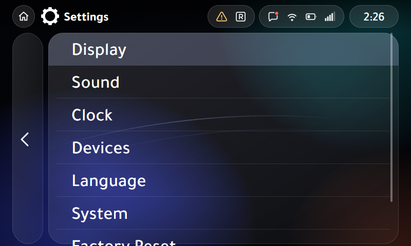 |

> Screenshots come from the desktop preview (`preview/index.html`). The top bar is Mazda's own
> status bar, which this project does not change.

## Status

**v1.2.1 — Ember Glance home screen plus the "Floating Pills" system skin, in every language.** Not yet tried in the car.
v1.0.4 (the first layout) runs in a 2019 CX-9 on firmware 74.00.333A (ADR / 4A N).

- v1.2.1 applies the system skin in English (and every other language) too, mirrored for Arabic.
- v1.2.0 adds the system skin for Mazda's own screens (see [System skin](#system-skin)):
  Tajawal everywhere, a top bar of floating glass pills with a new icon set, glass alerts, and menus in one
  rounded glass container.
- v1.1.0 replaces the big phone card with a live status card (car, phone, media), a parked / driving chip,
  a small Android Auto / CarPlay pill, and count badges on the dock (see [Live status](#live-status)).

- Installed and running in the car: Arabic right-to-left layout, knob, touch and the stock tiles work.
- v1.0.1 fixed the clock (the car's Linux clock is never set, so the time now comes from the Mazda framework).
- v1.0.2 hides the phone card when no phone is connected, and ships Tajawal with the Arabic presentation
  forms the car's browser needs (see [Fonts](#fonts)).
- v1.0.3 installs the fonts into the folder the browser really reads (`/jci/fonts/CHN` on firmware 74;
  earlier versions used `/jci/fonts`, which the browser never scans). Confirmed in the car: Tajawal loads.
- v1.0.4 turns off the "Font check" test line.
- The system skin passes 40 checks against Mazda's own CSS, in Arabic and English (fonts, alignment, focus, icons, alerts).
- The launcher passes 64 automated behaviour checks (knob, tilt, touch, every status state and its Arabic wording,
  phone hot-plug, focus hand-off, call and audio messages) and 9 clock checks.
- The installer passes 45 automated checks against a simulated car file system (install, reinstall, remove,
  wrong firmware, damaged USB copy, cancel, an existing `common_rtl.css`).

Treat it as experimental. Removing it is one step (see [Remove](#remove)).

## Features

- **Live status card** with three rows (see [Live status](#live-status)):
  - **Car:** number of warnings and whether maintenance is due, or "the car is OK". Opens Applications.
  - **Phone:** the Bluetooth phone's name with missed calls and new messages, or "call in progress". Opens Communication.
  - **Media:** the audio source and whether it's playing or paused. Opens Entertainment.
- **Parked / driving** chip under the date.
- **Android Auto / CarPlay pill** next to it, only while a phone is plugged in. Tapping it opens Android Auto / CarPlay.
- **Badges** on the dock: unread count (or a green dot during a call) on Phone, "!" on Apps when the car needs attention.
- **System skin**: Mazda's top bar, alerts, menus and back button restyled to match, all in Tajawal, in every language.
- **Arabic and right-to-left**: follows the car's language setting. Arabic labels, Arabic-Indic digits,
  Arabic day/month names, mirrored layout and background.
- **Hijri date** (Umm al-Qura) under the Gregorian date. The car's browser has no Hijri calendar, so a
  table covering 1445–1480 AH is built in.
- **Tajawal** font (installed into the system font folder).
- **Midnight background** with soft colour glows and light-trail arcs.
- Works with the **commander knob** (turn, tilt, press, up/down) and **touch** (when parked).
- Follows the car's **12/24-hour** setting. Other languages use Mazda's own translations for the tile names.

## Compatibility

| | |
|---|---|
| System | Mazda Connect **1** (CMU 150): the 7" / 8" screen with the semicircle home menu |
| Models | 2014–2018 Mazda3, 2016–2021 Mazda2/6/CX-3/CX-5/CX-9/MX-5 (any car that runs firmware 74) |
| Firmware | **74.x** required. Checked against **74.00.333A**. On other 74 builds the installer asks before going on. |
| Not for | Mazda Connect 2 (10.25" screen: 2019+ Mazda3/CX-30, 2021+ CX-5/CX-9 and newer) |

The Android Auto / CarPlay pill needs Mazda's Android Auto / CarPlay USB hub. Without it, the pill simply stays hidden.

It works alongside [oem-aa-mod](https://github.com/VitaliyKurokhtin/oem-aa-mod) (multi-touch / HUD for
Android Auto). The two change different files.

## How it works

Only the home-menu control is replaced:

| File on the car | Change |
|---|---|
| `/jci/gui/apps/system/controls/MainMenu/js/MainMenuCtrl.js` | replaced (same public API as Mazda's) |
| `/jci/gui/apps/system/controls/MainMenu/css/MainMenuCtrl.css` | replaced |
| `/jci/gui/apps/system/controls/MainMenu/css/MainMenuCtrl_rtl.css` | added; the framework loads it for Arabic/Hebrew |
| `/jci/gui/apps/system/controls/MainMenu/images/home2/` | added |
| `/jci/fonts/CHN/Home2Tajawal-Light.ttf`, `-Medium.ttf`, `-Bold.ttf` | added (the browser's font folder, see [Fonts](#fonts)) |
| `/jci/gui/common/css/home2skin.css` | added: the system skin (every language) |
| `/jci/gui/common/css/common_rtl.css` | added: the skin's Arabic mirroring (Mazda does not ship this file) |
| `/jci/gui/common/images/home2skin/` | added: the skin's images |

Mazda's system app (`systemApp.js`) is **not modified**. The launcher reads the phone state the system app
already publishes for its own small CarPlay / Android Auto button, and launches with the same
`SelectAndroidAuto` / `SelectCarPlay` events. The dock tiles and the three status rows call the stock select
callback (`nav`, `ent`, `com`, `set`, `app`).

### Live status

Everything on the status card comes from data the system app already keeps for its own menus, re-read once a second:

| Shown | Where the system app keeps it |
|---|---|
| Car warnings | the count badge on **Warning Guidance** in the Applications list (`WarningStatusCount` message) |
| Maintenance due | the system app's `_SchedMaintDueStatus` flag (`StatusUpdateSchedMaint` message) |
| Missed calls, new messages | the count badges on **Call History**, **SMS** and **Email** in the Communication list |
| Bluetooth phone name | the **Bluetooth** item in the Entertainment list |
| Audio source, playing | the "now playing" icon in the Entertainment list, plus the `StatusUpdateAudioSource` message |
| Active call | the `StatusPhoneCall` message |
| Driving / parked | `framework.common.getAtSpeedValue()` (Mazda's speed threshold) |

On firmware 74 the system app's own active-call handler never records the call (its check can't be true),
and it only keeps an icon for the audio source while it plays. So the launcher also observes those two
messages on their way to the system app's handlers, which still run unchanged.

### System skin

The skin is one new style sheet, `common/css/home2skin.css`, that the launcher adds to the page when it loads,
so it restyles every Mazda screen in every language without changing any Mazda file. For Arabic, Mazda's GUI also
loads `common/css/common_rtl.css` next to `common.css` (Mazda does not ship that file); Home 2.0 puts the mirrored
top-bar layout there, and the GUI drops it again when you switch to English. Remove deletes both and the stock
look is back.

- **Fonts:** every screen in Tajawal (Medium for text, Bold for titles and alerts) instead of Tipperary and the
  system Arabic fallback.
- **Top bar:** no bar background; the home / Android Auto / CarPlay button as a round pill at the start, the
  screen title next to it, the status icons in glass pills, and the clock in a glass pill at the end (in Arabic
  the clock is on the left and the button on the right). New icons
  for every battery, signal and Wi-Fi level, Bluetooth, messages, music, roaming and traffic: Mazda's code names the
  icon image for each state, and the skin swaps in its own image for each name. The launcher marks which icon
  groups have a visible icon, so empty groups don't show an empty pill.
- **Alerts** (navigation, Bluetooth, volume, messages): a glass pill between the button and the clock.
- **Menus:** one rounded glass container whose right edge lines up with the top bar; rows fill it edge to edge and
  the focused row is filled across its full width. Rows keep Mazda's size and text positions. The back button
  is a glass pill beside it. The Midnight background replaces Mazda's grey one.

The top-bar clock is written by Mazda's code, so it stays in English digits.

Not available to the screen on firmware 74: oil life %, km to service and fuel economy (Mazda sends them only
while their own screens are open), fuel level, range, odometer, tyre pressure, outside temperature and weather.

Before changing anything the installer:

1. checks the firmware is version 74,
2. checks every file on the USB stick against `home2/checksums.md5`,
3. checks Mazda's home-menu files against the known originals (asks you if they differ),
4. backs up the originals to `/data_persist/home2-backup/` on the car **and** to `backup/` on the USB stick,
5. copies the new files, verifies them, and restores the originals if anything failed.

## What you need

- Mazda Connect on **firmware 74** (Settings → System → About → OS Version 74.xx.xxx).
  Not there yet? Update first with Mazda's firmware for your region.
- A **USB stick**, 32 GB or smaller, formatted **FAT32 (MBR)**.
- A **USB keyboard** (any wired one). The installer runs from the unit's terminal, which only takes a keyboard.
- The car **parked**.

## Install

1. **Download** `home2-installer-<version>.zip` from [Releases](../../releases) (or build it, see below).
2. **Prepare the stick.** Format it FAT32 (MBR). Extract the zip so its contents sit at the **root** of the stick:
   ```
   USB:\run.sh
   USB:\js\run.js
   USB:\mp3\a.mp3  b.mp3  c.mp3  d.mp3
   USB:\home2\...
   ```
   Nothing else should be on the stick.
3. **In the car**, parked, start the car (or ACC). Unplug your phone.
   Insert the **USB stick** in one USB port and the **keyboard** in the other.
4. Go to **Entertainment → USB** and play the tracks. Within about 15 seconds the screen switches to
   **Diagnostics** on its own and a **terminal** opens. Don't touch the screen while it switches.
5. On the keyboard, find where the stick is mounted, then start the installer:
   ```sh
   ls /tmp/mnt
   sh /tmp/mnt/sda1/run.sh
   ```
   Use whatever `ls` showed instead of `sda1` (for example `sdb1`). **Tab** completes names.
6. A dialog asks **Install** or **Remove**. Choose **Install**.
   If your files differ from the tested version you'll be asked once more ("Install anyway").
7. Wait for **"Home 2.0 installed!"**. The unit restarts by itself. Remove the stick and keyboard.
8. For Arabic: **Settings → System → Language → العربية**.

## Remove

Repeat the install steps 3–5 with the same stick and choose **Remove**. The original files come back from the
backup and the unit restarts.

### If the home screen ever fails to show

Press the **music / Entertainment** button next to the commander knob (it opens Entertainment directly),
choose **USB**, and run the steps above with **Remove**. Logs are written to `logs/` on the stick
(`install.log`, `remove.log`). Please attach them to an issue.

### After a Mazda firmware update

A firmware update rewrites these files, so the stock home screen comes back. Run the installer again.

## Configuration

At the top of `src/launcher/MainMenuCtrl.js`:

```js
var HOME2_CONFIG = {
    arabicDigits : true,   // ٠١٢٣ instead of 0123 when the system language is Arabic
    statusPollMs : 1000,   // how often to re-read phone and car status
    clockMs : 5000,        // clock refresh
    fontCheck : false      // true shows a "Font check" line (for testing in the car)
};
```

Rebuild after changing it.

## Fonts

The car's browser (Opera Presto) does not load web fonts, so Tajawal is installed as a system font.
The browser loads fonts from the folder in its `OPERA_FONTS` setting. `/jci/opera/run-Opera` says
`/jci/fonts`, but the system manager does not use that script: it starts Opera with the environment from
`/etc/profile`, which sets `/jci/fonts/CHN`. The installer asks the running browser for its `OPERA_FONTS`
(falling back to `/etc/profile`, then `/jci/fonts/CHN`) and installs the fonts there. Presto also draws Arabic using the **presentation form** characters (U+FB50–FDFF,
U+FE70–FEFF). The original Tajawal only maps some of them, so Presto fell back to Mazda's own Arabic font
for the missing letters. `tools/rename_fonts.py` fixes this: it adds the missing forms (pointing each at the
glyph HarfBuzz picks for that letter and position) and gives each weight its own family name
("Home2 Tajawal Light / Medium / Bold"). The originals are kept in `src/fonts/`.

With `fontCheck : true`, a "Font check" line shows, for each weight, whether Arabic (AR) and Latin (EN) text is drawn with Tajawal
(`OK`) or with a fallback font (`NO`).

## Build from source

```sh
pip install pillow numpy cairosvg hijridate mutagen fonttools uharfbuzz   # plus ffmpeg on your PATH
python3 tools/build_assets.py   # backgrounds, icon chips, arrows
python3 tools/rename_fonts.py   # src/fonts -> installer/home2/fonts/Home2Tajawal-*.ttf
python3 tools/gen_hijri.py      # Umm al-Qura table -> src/launcher/hijri.js
python3 tools/make_trigger.py   # the USB trigger MP3s
./build.sh                      # installer/home2/* and dist/home2-installer-<version>.zip
sh tests/test_installer.sh      # installer tests on a simulated car file system
(cd tests/browser && npm install && npm test)   # ES5 check, launcher behaviour, screenshots, clock, skin
```

The skin test renders `preview/skin.html` on top of Mazda's own CSS, which is not in this repository. Copy it from
an extracted firmware first (it stays local, `preview/mazda/` is git-ignored); without it the skin test is skipped:

```sh
sh tools/copy_mazda_preview.sh <extracted firmware>/jci/gui
```

The browser tests use a bundled Linux Chromium by default. On Windows (or to use your own browser), point them
at Chrome and use Node 18 or newer:

```sh
cd tests/browser && CHROME_PATH="C:/Program Files/Google/Chrome/Application/chrome.exe" npm test
```

Open `preview/index.html` in a desktop browser to try the launcher (keys: ← → tilt, `[` `]` rotate,
↑ ↓, Enter; the mouse acts as touch). URL options: `?lang=ar_SA|en_US`, `&phone=none|androidauto|carplay`,
`&fmt=12hrs|24hrs`, and for the status card `&warnings=2&service=1&missed=3&texts=1&call=1&bt=<name>`
`&source=FMRadio|USB_A|BTAudio|AndroidAuto|CarPlay&playing=0|1&driving=1`. Plugging and unplugging a phone can be
tried from the browser console: `framework.common._remoteUiBtns.system = {appName: 'carplay'}` or `= null`;
status changes with `setStatus({warnings: 1, call: true, driving: true})`.

The car's browser is Opera Presto: launcher code must stay **ES5** with no flexbox.

### Layout

```
src/launcher/       MainMenuCtrl.js, MainMenuCtrl.css, MainMenuCtrl_rtl.css, hijri.js (generated)
installer/          everything that goes on the USB stick
  run.sh            install / remove (busybox sh)
  js/run.js, mp3/   opens the terminal when the USB tracks play
  home2/            payload: js/, css/, images/home2/, fonts/, checksums.md5
tools/              asset and table generators
tests/              installer tests
preview/            desktop preview with a stubbed Mazda framework
docs/               screenshots
```

## Credits

- **Tajawal** font by Boutros International, SIL Open Font License 1.1 (`installer/home2/fonts/OFL.txt`).
  The installed copies are modified (renamed, presentation forms added) as the license allows; Tajawal has no
  Reserved Font Name.
- The USB-MP3 way of opening the terminal is a long-standing Mazda Connect community technique
  (MZD-AIO, mzd-connect-1-root, the oem-aa-mod installer by Bijan-A). This project ships its own trigger files.
- Firmware research: the mazda3revolution.com and mazdas247.com communities.

## Disclaimer

Not affiliated with or endorsed by Mazda. Modifying your infotainment unit may affect your warranty and is
done **at your own risk**. Install only while parked, and don't operate the screen while driving.

## License

Apache License 2.0 for this project's code and images (see `LICENSE`). The Tajawal font files are under the
SIL Open Font License 1.1 (`installer/home2/fonts/OFL.txt`). No Mazda files are included in this repository.
