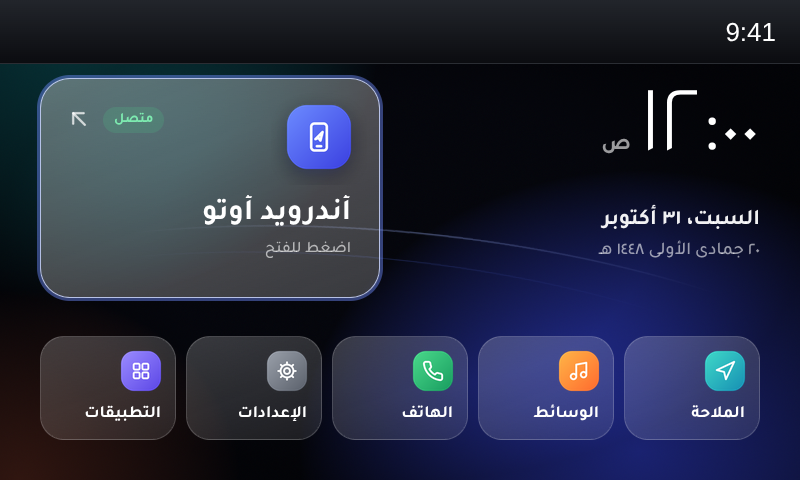
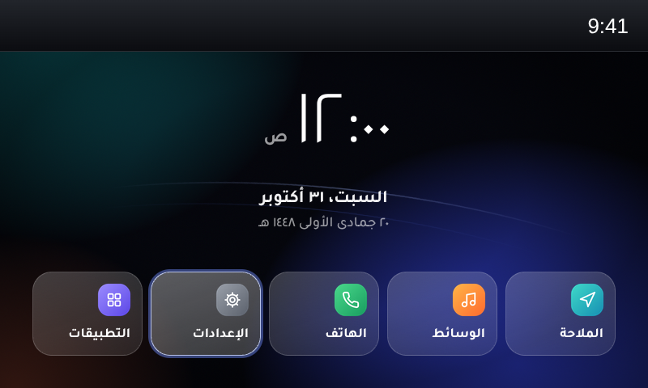
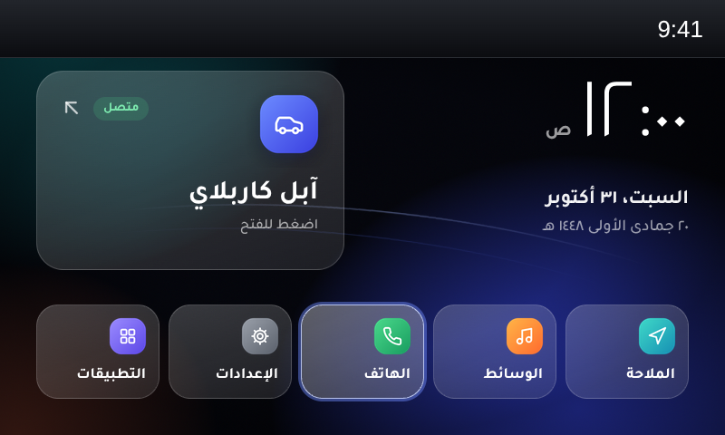
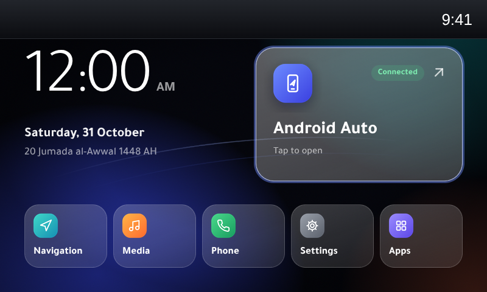

# Home 2.0 — a modern home screen for Mazda Connect

A new home screen ("Ember Glass") for Mazda Connect 1 infotainment units on firmware 74.
Arabic-first with full right-to-left layout, Tajawal font, Hijri date, and a phone card that
appears when **Android Auto** or **Apple CarPlay** is connected and hides when no phone is plugged in.

| Arabic · Android Auto | Arabic · no phone |
|---|---|
|  |  |
| **Arabic · CarPlay** | **English · Android Auto** |
|  |  |

> Screenshots come from the desktop preview (`preview/index.html`). The top bar is Mazda's own
> status bar, which this project does not change.

## Status

**v1.0.4 — running in a 2019 CX-9 on firmware 74.00.333A (ADR / 4A N).**

- Installed and running in the car: Arabic right-to-left layout, knob, touch and the stock tiles work.
- v1.0.1 fixed the clock (the car's Linux clock is never set, so the time now comes from the Mazda framework).
- v1.0.2 hides the phone card when no phone is connected, and ships Tajawal with the Arabic presentation
  forms the car's browser needs (see [Fonts](#fonts)).
- v1.0.3 installs the fonts into the folder the browser really reads (`/jci/fonts/CHN` on firmware 74;
  earlier versions used `/jci/fonts`, which the browser never scans). Confirmed in the car: Tajawal loads.
- v1.0.4 turns off the "Font check" test line.
- The launcher passes 23 automated behaviour checks (knob, tilt, touch, phone hot-plug, focus hand-off) and
  9 clock checks.
- The installer passes 32 automated checks against a simulated car file system (install, reinstall, remove,
  wrong firmware, damaged USB copy, cancel).

Treat it as experimental. Removing it is one step (see [Remove](#remove)).

## Features

- **Phone card** that appears when Android Auto or CarPlay is plugged in, with a "Connected" badge.
  Tapping it opens Android Auto / CarPlay. With no phone, the card is hidden and the clock moves to the centre.
- **Arabic and right-to-left**: follows the car's language setting. Arabic labels, Arabic-Indic digits,
  Arabic day/month names, mirrored layout and background.
- **Hijri date** (Umm al-Qura) under the Gregorian date. The car's browser has no Hijri calendar, so a
  table covering 1445–1480 AH is built in.
- **Tajawal** font (installed into the system font folder).
- **Midnight background** with soft colour glows and light-trail arcs.
- Works with the **commander knob** (turn, tilt, press, up/down) and **touch** (when parked).
- Follows the car's **12/24-hour** setting. Other languages use Mazda's own translations for the tile names.

## Compatibility

| | |
|---|---|
| System | Mazda Connect **1** (CMU 150): the 7" / 8" screen with the semicircle home menu |
| Models | 2014–2018 Mazda3, 2016–2021 Mazda2/6/CX-3/CX-5/CX-9/MX-5 (any car that runs firmware 74) |
| Firmware | **74.x** required. Checked against **74.00.333A**. On other 74 builds the installer asks before going on. |
| Not for | Mazda Connect 2 (10.25" screen: 2019+ Mazda3/CX-30, 2021+ CX-5/CX-9 and newer) |

The phone card needs Mazda's Android Auto / CarPlay USB hub. Without it, the card simply stays hidden.

It works alongside [oem-aa-mod](https://github.com/VitaliyKurokhtin/oem-aa-mod) (multi-touch / HUD for
Android Auto). The two change different files.

## How it works

Only the home-menu control is replaced:

| File on the car | Change |
|---|---|
| `/jci/gui/apps/system/controls/MainMenu/js/MainMenuCtrl.js` | replaced (same public API as Mazda's) |
| `/jci/gui/apps/system/controls/MainMenu/css/MainMenuCtrl.css` | replaced |
| `/jci/gui/apps/system/controls/MainMenu/css/MainMenuCtrl_rtl.css` | added; the framework loads it for Arabic/Hebrew |
| `/jci/gui/apps/system/controls/MainMenu/images/home2/` | added |
| `/jci/fonts/CHN/Home2Tajawal-Light.ttf`, `-Medium.ttf`, `-Bold.ttf` | added (the browser's font folder, see [Fonts](#fonts)) |

Mazda's system app (`systemApp.js`) is **not modified**. The launcher reads the phone state the system app
already publishes for its own small CarPlay / Android Auto button, and launches with the same
`SelectAndroidAuto` / `SelectCarPlay` events. The other five tiles call the stock select callback
(`nav`, `ent`, `com`, `set`, `app`).

Before changing anything the installer:

1. checks the firmware is version 74,
2. checks every file on the USB stick against `home2/checksums.md5`,
3. checks Mazda's home-menu files against the known originals (asks you if they differ),
4. backs up the originals to `/data_persist/home2-backup/` on the car **and** to `backup/` on the USB stick,
5. copies the new files, verifies them, and restores the originals if anything failed.

## What you need

- Mazda Connect on **firmware 74** (Settings → System → About → OS Version 74.xx.xxx).
  Not there yet? Update first with Mazda's firmware for your region.
- A **USB stick**, 32 GB or smaller, formatted **FAT32 (MBR)**.
- A **USB keyboard** (any wired one). The installer runs from the unit's terminal, which only takes a keyboard.
- The car **parked**.

## Install

1. **Download** `home2-installer-<version>.zip` from [Releases](../../releases) (or build it, see below).
2. **Prepare the stick.** Format it FAT32 (MBR). Extract the zip so its contents sit at the **root** of the stick:
   ```
   USB:\run.sh
   USB:\js\run.js
   USB:\mp3\a.mp3  b.mp3  c.mp3  d.mp3
   USB:\home2\...
   ```
   Nothing else should be on the stick.
3. **In the car**, parked, start the car (or ACC). Unplug your phone.
   Insert the **USB stick** in one USB port and the **keyboard** in the other.
4. Go to **Entertainment → USB** and play the tracks. Within about 15 seconds the screen switches to
   **Diagnostics** on its own and a **terminal** opens. Don't touch the screen while it switches.
5. On the keyboard, find where the stick is mounted, then start the installer:
   ```sh
   ls /tmp/mnt
   sh /tmp/mnt/sda1/run.sh
   ```
   Use whatever `ls` showed instead of `sda1` (for example `sdb1`). **Tab** completes names.
6. A dialog asks **Install** or **Remove**. Choose **Install**.
   If your files differ from the tested version you'll be asked once more ("Install anyway").
7. Wait for **"Home 2.0 installed!"**. The unit restarts by itself. Remove the stick and keyboard.
8. For Arabic: **Settings → System → Language → العربية**.

## Remove

Repeat the install steps 3–5 with the same stick and choose **Remove**. The original files come back from the
backup and the unit restarts.

### If the home screen ever fails to show

Press the **music / Entertainment** button next to the commander knob (it opens Entertainment directly),
choose **USB**, and run the steps above with **Remove**. Logs are written to `logs/` on the stick
(`install.log`, `remove.log`). Please attach them to an issue.

### After a Mazda firmware update

A firmware update rewrites these files, so the stock home screen comes back. Run the installer again.

## Configuration

At the top of `src/launcher/MainMenuCtrl.js`:

```js
var HOME2_CONFIG = {
    arabicDigits : true,   // ٠١٢٣ instead of 0123 when the system language is Arabic
    phonePollMs : 1000,    // how often to check for a connected phone
    clockMs : 5000,        // clock refresh
    fontCheck : false      // true shows a "Font check" line (for testing in the car)
};
```

Rebuild after changing it.

## Fonts

The car's browser (Opera Presto) does not load web fonts, so Tajawal is installed as a system font.
The browser loads fonts from the folder in its `OPERA_FONTS` setting. `/jci/opera/run-Opera` says
`/jci/fonts`, but the system manager does not use that script: it starts Opera with the environment from
`/etc/profile`, which sets `/jci/fonts/CHN`. The installer asks the running browser for its `OPERA_FONTS`
(falling back to `/etc/profile`, then `/jci/fonts/CHN`) and installs the fonts there. Presto also draws Arabic using the **presentation form** characters (U+FB50–FDFF,
U+FE70–FEFF). The original Tajawal only maps some of them, so Presto fell back to Mazda's own Arabic font
for the missing letters. `tools/rename_fonts.py` fixes this: it adds the missing forms (pointing each at the
glyph HarfBuzz picks for that letter and position) and gives each weight its own family name
("Home2 Tajawal Light / Medium / Bold"). The originals are kept in `src/fonts/`.

With `fontCheck : true`, a "Font check" line shows, for each weight, whether Arabic (AR) and Latin (EN) text is drawn with Tajawal
(`OK`) or with a fallback font (`NO`).

## Build from source

```sh
pip install pillow numpy cairosvg hijridate mutagen fonttools uharfbuzz   # plus ffmpeg on your PATH
python3 tools/build_assets.py   # backgrounds, icon chips, arrows
python3 tools/rename_fonts.py   # src/fonts -> installer/home2/fonts/Home2Tajawal-*.ttf
python3 tools/gen_hijri.py      # Umm al-Qura table -> src/launcher/hijri.js
python3 tools/make_trigger.py   # the USB trigger MP3s
./build.sh                      # installer/home2/* and dist/home2-installer-<version>.zip
sh tests/test_installer.sh      # installer tests on a simulated car file system
```

Open `preview/index.html` in a desktop browser to try the launcher (keys: ← → tilt, `[` `]` rotate,
↑ ↓, Enter; the mouse acts as touch). URL options: `?lang=ar_SA|en_US`, `&phone=none|androidauto|carplay`,
`&fmt=12hrs|24hrs`. Plugging and unplugging a phone can be tried from the browser console:
`framework.common._remoteUiBtns.system = {appName: 'carplay'}` or `= null`.

The car's browser is Opera Presto: launcher code must stay **ES5** with no flexbox.

### Layout

```
src/launcher/       MainMenuCtrl.js, MainMenuCtrl.css, MainMenuCtrl_rtl.css, hijri.js (generated)
installer/          everything that goes on the USB stick
  run.sh            install / remove (busybox sh)
  js/run.js, mp3/   opens the terminal when the USB tracks play
  home2/            payload: js/, css/, images/home2/, fonts/, checksums.md5
tools/              asset and table generators
tests/              installer tests
preview/            desktop preview with a stubbed Mazda framework
docs/               screenshots
```

## Credits

- **Tajawal** font by Boutros International, SIL Open Font License 1.1 (`installer/home2/fonts/OFL.txt`).
  The installed copies are modified (renamed, presentation forms added) as the license allows; Tajawal has no
  Reserved Font Name.
- The USB-MP3 way of opening the terminal is a long-standing Mazda Connect community technique
  (MZD-AIO, mzd-connect-1-root, the oem-aa-mod installer by Bijan-A). This project ships its own trigger files.
- Firmware research: the mazda3revolution.com and mazdas247.com communities.

## Disclaimer

Not affiliated with or endorsed by Mazda. Modifying your infotainment unit may affect your warranty and is
done **at your own risk**. Install only while parked, and don't operate the screen while driving.

## License

Apache License 2.0 for this project's code and images (see `LICENSE`). The Tajawal font files are under the
SIL Open Font License 1.1 (`installer/home2/fonts/OFL.txt`). No Mazda files are included in this repository.
